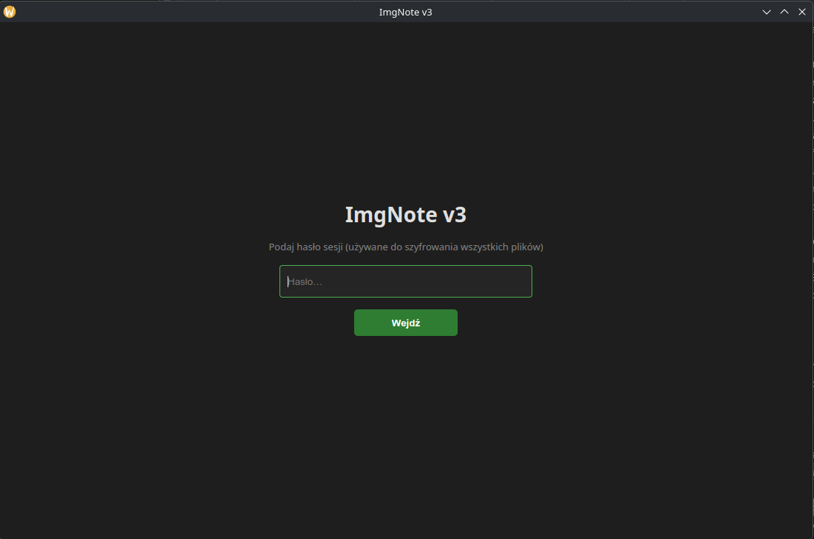
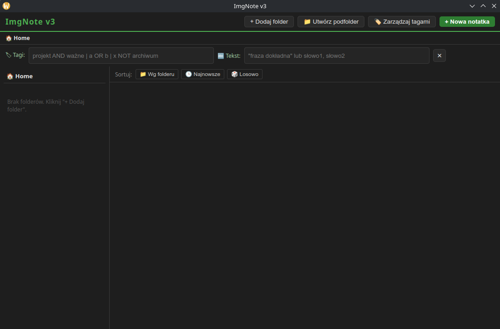

🇵🇱 [Polska wersja](README.pl.md)

# ImgNote v3

A local, encrypted note manager for images and documents that need to stay protected — medical scans with descriptions, blueprints, ID documents, anything sensitive you still want to tag, search, and browse like a normal gallery instead of burying in an encrypted zip.

## Why

Most of what you'd otherwise store this way ends up as an unsearchable pile of encrypted archives, or unencrypted and just hoping no one looks. This keeps every item individually encrypted, but still taggable, searchable, and viewable through a normal app.

## Screenshots

| Login | Gallery |
|---|---|
|  |  |

## How it works

- Each item is saved as a single `.imgnote` file — a custom binary format (`IMNG` header) storing the image, a text note, tags, title, and folder path, encrypted with **AES-GCM** using a key derived from your password via **Scrypt**. Nothing is stored or transmitted unencrypted. Filenames on disk are random — titles and folder structure live only inside the encrypted payload, never exposed on the filesystem itself.
- A separate encrypted index (own salt, same envelope format) tracks tags and folder paths for fast lookups, so opening the gallery or searching doesn't require decrypting every note — only files that changed since the last session get re-decrypted and re-indexed on startup.
- Non-image documents (`.pdf`, `.docx`, `.doc`, `.odt`, `.rtf`, `.txt`, `.md`) get their text extracted on import, so the content itself becomes searchable even though the file is encrypted.
- **Search** supports boolean tag queries (`project AND important`, `(draft OR sketch) AND important`, partial tag matching, with autocomplete) and text search (exact phrases, AND word-lists, plain substrings) — tag filtering runs against the index; text search still decrypts.
- **Folders are virtual** — organized entirely through an encrypted field on each note, not real directories on disk. Create, rename, move, and delete them from a right-click menu on the folder tree; renaming or moving cascades to every note underneath.
- Every secondary view — viewer, editor, tag manager, settings — opens as a layered popup over the gallery instead of a separate screen, so context is never lost (e.g. edit a note's tags from the viewer, close back into the exact same spot).
- The viewer supports zoom/pan on the image, keyboard navigation between notes, and inline Markdown editing without leaving the popup.
- The tag manager can rename, merge, or delete a tag across every note that uses it, with a live usage count and progress feedback for the bulk rewrite.
- A settings popup controls thumbnail size and note content font size (persisted locally).

## Tech stack

Python backend (pywebview, PyQt6, `cryptography` for AES-GCM/Scrypt, `Pillow` for thumbnails, `cachetools` for the bounded note cache, PyMuPDF/python-docx/odfpy/striprtf for document text extraction) · HTML/CSS/vanilla JS frontend.

## Status

Personal project, actively developed. Started as a PyQt6 GUI, migrated to this pywebview-based app, then rebuilt from a single ~700-line God object into a modular backend (encrypted index instead of a linear scan, bounded LRU cache, dedicated folder/search/index managers) plus a redesigned, popup-based frontend.
