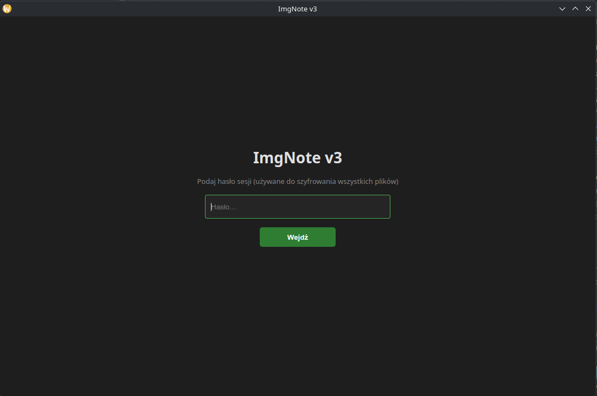
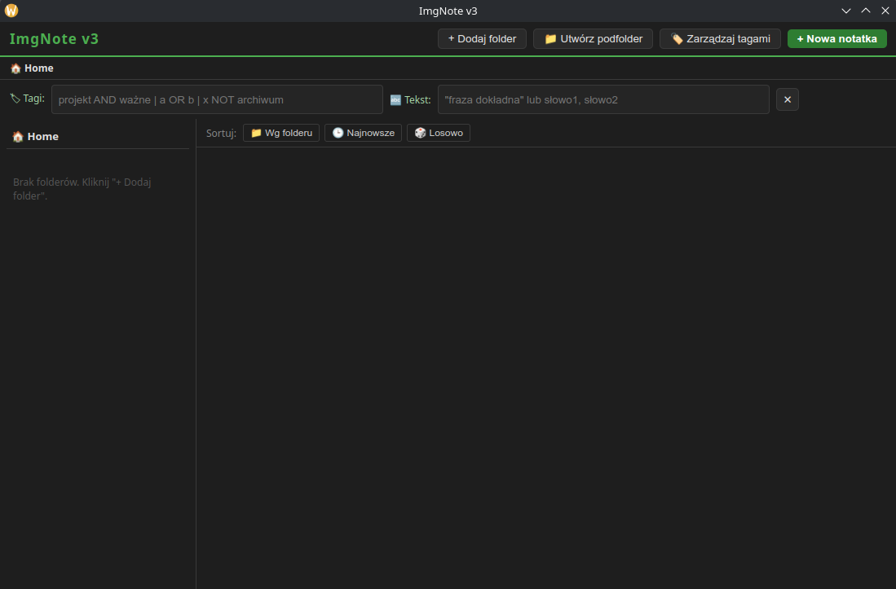

🇬🇧 [English version](README.md)

# ImgNote v3

Lokalny, szyfrowany menedżer notatek dla obrazów i dokumentów, które muszą pozostać chronione — zdjęcia medyczne z opisami, plany/blueprinty, dokumenty tożsamości, cokolwiek wrażliwego, co mimo to chcesz tagować, przeszukiwać i przeglądać jak zwykłą galerię, zamiast zakopywać w zaszyfrowanym zipie.

## Po co

Rzeczy tego typu zwykle kończą jako nieprzeszukiwalna sterta zaszyfrowanych archiwów, albo w ogóle bez szyfrowania, "bo nikt nie zajrzy". Tu każdy element jest szyfrowany osobno, ale wciąż tagowalny, przeszukiwalny i przeglądalny przez zwykłą aplikację.

## Zrzuty ekranu

| Logowanie | Galeria |
|---|---|
|  |  |

## Jak to działa

- Każdy element zapisywany jest jako pojedynczy plik `.imgnote` — własny format binarny (nagłówek `IMNG`) przechowujący obraz, notatkę tekstową i tagi, szyfrowany **AES-GCM** z kluczem wyprowadzonym z hasła przez **Scrypt**. Nic nie jest zapisywane ani przesyłane bez szyfrowania.
- Dokumenty inne niż obrazy (`.pdf`, `.docx`, `.doc`, `.odt`, `.rtf`, `.txt`, `.md`) mają tekst wyciągany przy imporcie, więc treść jest przeszukiwalna mimo że plik jest zaszyfrowany.
- **Wyszukiwanie** wspiera boolowskie zapytania po tagach (`projekt AND ważne`, `(szkic OR draft) AND ważne`, częściowe dopasowanie tagu) i wyszukiwanie tekstowe (dokładne frazy, listy słów AND, zwykłe podciągi).
- Widoki galerii, podglądu, edytora i menedżera tagów w jednej aplikacji.

## Stos technologiczny

Backend Python (pywebview, PyQt6, `cryptography` do AES-GCM/Scrypt, PyMuPDF/python-docx/odfpy/striprtf do ekstrakcji tekstu z dokumentów) · frontend HTML/CSS/vanilla JS.

## Status

Projekt osobisty, aktywnie rozwijany. Zaczynał jako GUI w PyQt6 i został przeniesiony na to pywebview — ta migracja jest już praktycznie zakończona.
